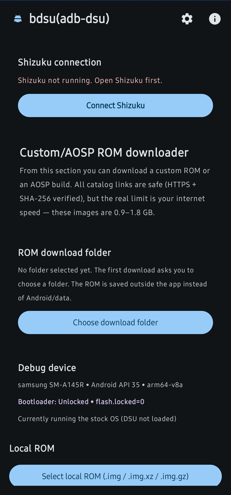
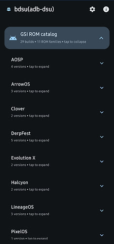
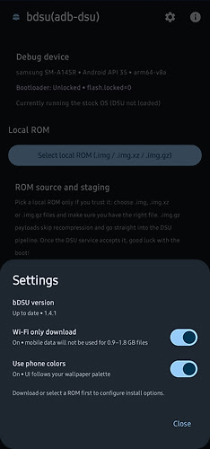

**bDSU** is an Android app for installing GSI ROMs through DSU (Dynamic System Updates). Pick a ROM from the built-in catalog or a local file, let bDSU verify and package it, then reboot into it. Shizuku provides the shell access.

> 💡 **Note:** Downloads include automatic **hash verification** to guarantee file integrity!

## Screenshots

| Main screen | GSI ROM catalog | Settings |
|---|---|---|
|  |  |  |

More detail in [`screenshots/README.md`](screenshots/README.md).

### What's new in 1.4.1
* **Correct XZ memory limit** — the decompressor cap is now 96 MiB (KiB units), `android:largeHeap` is gone, and every `XZInputStream` uses the same helper.
* **Process-wide install engine** — installs survive rotation, theme changes and leaving the screen. A `dataSync` foreground service with a partial wake lock keeps long staging jobs alive.
* **Real-time progress** — every stage (download, SHA-256, decompression, gzip, copy, launch) shows bytes, MB/s, bytes left and an ETA. The `/data/local/tmp` copy and the SD → internal fallback now report live throughput too.
* **Large images always allowed** — the "Allow images larger than 4 GB" setting was removed; a 64 GB decompressed-size safety limit remains as a guard against corrupt streams.
* **Quiet update check** — one GitHub release check per 12 hours, ETag-aware, with correct prerelease ordering and a low-importance notification.
* **Single top progress card** — one card for download, packaging and install; duplicate indicators removed.
* **Smaller APK** — R8 + resource shrinking in debug and release; the release APK is about 2.1 MB.
* **New adaptive icon** — themed/monochrome launcher icon and a tinted Android mark for the GSI catalog.

See [`RELEASE_NOTES.md`](RELEASE_NOTES.md) for the full 1.4.1 notes and [`MODIFICATIONS.txt`](MODIFICATIONS.txt) for the complete change notice.

### Previous versions

Older release details are in [`MODIFICATIONS.txt`](MODIFICATIONS.txt) and the [GitHub Releases](https://github.com/ayzlol/bdsu-adb-dsu/releases) page.

### Credits & Thanks
* **Shizuku**: Huge thanks to the Shizuku project! bDSU relies on Shizuku to function :3
* **unfayd**: A big thank you to unfayd for helping with code and testing (and being the best friend ever :d).

---

### Notes & License
bDSU is a hobby project. Full transparency: yes, I used AI to help build this, but I put a ton of effort into testing DSU setups, downloads, and features directly on my own device.

If you like this project, giving it a star ⭐ or sharing it would mean a lot! You are totally free to fork, modify, or customize the app (as long as it's not for malicious intent). If you do release modified versions or fixes, please credit us and link back to this repo :p

### Disclaimer
* Installing DSU requires an **unlocked bootloader**.
* Even though DSU is safer than standard flashing, please proceed with caution. **I assume no responsibility for any potential issues or damages.**

Wishing you all the best and good luck installing DSUs! :dddddd

### New Update
* **New download options added.**
* **Notifications added.**
* **Cancel buttons added.**
* **More detail during installation added.**
* **And now you choose the file path!** :p
* **A few more solid optimizations and stability improvements** so users run into fewer errors. :d
