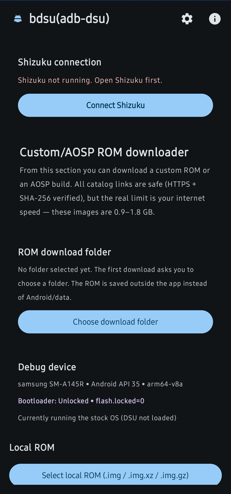
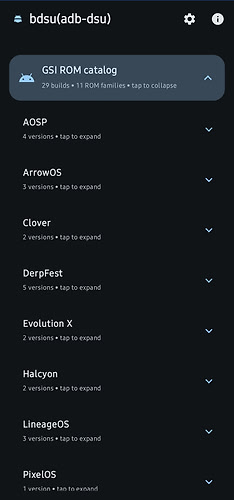
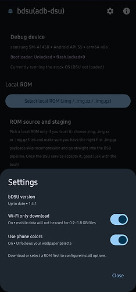

# bDSU screenshots

Screens captured on a Samsung SM-A145R running Android 15 (API 35) with bDSU 1.4.1.

| # | Screen | What it shows |
|---|--------|---------------|
| 1 | [`01-main-screen.jpg`](01-main-screen.jpg) | Main screen: Shizuku connection state, the custom/AOSP ROM downloader, the ROM download folder, debug device information (model, API level, ABI, bootloader) and the local ROM picker. |
| 2 | [`02-gsi-rom-catalog.jpg`](02-gsi-rom-catalog.jpg) | The collapsible GSI ROM catalog drawer: 29 builds across 11 ROM families, each family expanding to its versions. |
| 3 | [`03-settings.jpg`](03-settings.jpg) | Settings dialog: version and update state ("Up to date • 1.4.1"), Wi-Fi-only downloads and "Use phone colors" (Material You). |

## Gallery

| Main screen | GSI ROM catalog | Settings |
|---|---|---|
|  |  |  |
